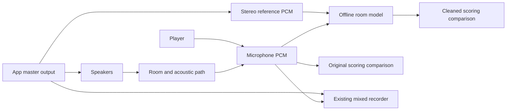

# Acoustic bleed research lab

Local feasibility investigation, 16 November 2026. Production application files are unchanged. Nothing in the app imports this directory. The lab runs in a local Linux container and exposes only a loopback web port.

Reference cancellation is promising for a stationary, reasonably linear speaker/room path. It is **not ready to enable in scoring**: pitch agreement improved strongly in controlled mixtures, but note segmentation was not invariant, and clock drift, clipping and room changes reduced the benefit. This lab collects the paired real recordings needed for the next decision.

## Use the test page

On another computer, install Node.js 22 or newer and start a local Docker engine configured for Linux containers. Docker Desktop is suitable. Allow at least 3 GB of container memory. Python, npm dependencies and the analysis libraries are installed inside the container; no account credentials or local environment files are needed. The first build and sample loading require internet access.

From an existing repository clone:

```sh
git fetch origin
git switch --track origin/codex/acoustic-bleed-lab
```

Then, from the repository root:

```sh
node research/acoustic-bleed/start.mjs
```

The page can capture new takes on a fresh checkout. Previously generated experiment WAVs and local browser recordings are not included in Git; the numeric research results are included.

Open [the local test page](http://localhost:5188/research/acoustic-bleed/lab.html) manually. Choose Ear training or Lick practice, a phrase, concert key, register, tempo, and Metronome or Backing track. Ear training offers the app's beginner cells; Lick practice offers the curated catalog. Import a supported phrase or diagnostic JSON to try a personal lick. This first lab accepts 4/4 phrases lasting up to 30 seconds. It uses the real app playback engine and samples; it does not reproduce adaptive progression, continuous key rotations or account persistence.

Start a take and follow the cues: Stay silent during four calibration bars, listen to the phrase, enter after the count-in, then stay silent during four final calibration bars. Keep the speaker/microphone position and output volume unchanged. The page requests unprocessed microphone audio only after Start. Stop releases the microphone and cancels playback.

Compare Original microphone and Cleaned microphone over the same playing window. Saved playback remains the original mixed session, including calibration and demonstration. Download the paired capture before leaving the page: It contains raw microphone PCM, stereo output PCM, frame timing, phrase, tempo and capture settings. Download analysis separately. Audio is processed in the local Linux service, kept in browser memory, and never sent to a cloud service. Sample banks may be downloaded from the app's normal sample provider. Reloading or closing the page discards undownloaded takes.

To stop the local lab:

```sh
node research/acoustic-bleed/start.mjs --stop
```

## Capture and cancellation

The page imports `playback.ts`, `metronome.ts` through playback, the backing engine, the curated phrases, `recorder.ts`, replay, segmentation and scoring. It does not modify them. A research AudioWorklet captures the mic and post-master left/right output in one processing callback, with a shared `currentFrame` origin. Its output is silent so it cannot monitor the mic into the speakers. The existing recorder independently captures the listening mix. The cancelled waveform is used only for the comparison analysis.



The implementation estimates a bulk delay up to 400 ms from waveform correlation during calibration. It compares initial and final silent regions for a bounded, linear drift estimate (up to ±500 ppm), then warps only the reference. The microphone timeline never moves. A ridge-regularized 200 ms FIR room filter is fitted on the first 70% of calibration, checked on its held-out final portion, and frozen during playing. Separate filters support stereo reference channels. Less than 3 dB validation improvement or weak correlation returns the original audio unchanged. This is a diagnostic guard, not a guarantee of preservation. Calibration contaminated by playing, correlated accompaniment, periodic clicks, movement and later room changes remain risks.

The model operates at 24 kHz and upsamples its echo estimate for subtraction from the untouched full-rate microphone; energy above 12 kHz is largely untreated. The 100-iteration solver reached its iteration budget in the controlled runs. The held-out reduction, rather than numerical convergence, decided acceptance. No suppression mask, noise gate, AGC or speech enhancement is applied. Scores use the app's real detector, segmentation and scoring functions with identical settings for both inputs; scheduled bleed vetoes and the note-level bleed filter are disabled to isolate this experiment. They are research comparisons, not claimed production-score parity.

The live calibration vamps on the phrase's first chord. It may not excite every frequency needed by later chords, and periodic metronome signals can make delay ambiguous. Stereo independent-speaker room accuracy is not established by the mono experiment matrix. The native master tap uses standardized-audio-context's private `_nativeAudioNode` bridge, checked against the capture context; its compatibility must be revisited if that dependency changes.

## Controlled evidence

The references were rendered in Linux Chromium using the production backing WAV renderer with `golden-lab-blues-f-160.json`, and the production metronome synth/scheduler inside Tone Offline. The precise rendered waveform was retained, including noise. The backing was downmixed to mono for this first matrix. A seeded room model supplied 115 ms bulk delay, reflections and a 0.28 s decay, with optional 200 ppm drift, a 5 ms/level path change, or soft speaker saturation. The player signal was a sequence of the repository's recorded tenor samples. These are controlled sample-based performances, not live paired room captures.

One additional preservation case treated the existing `2026-09-09-blue-note-drop.wav` as the target and added known new echo. That archived target already contains its old mix; the experiment measures removal of the added echo and preservation relative to that target, not removal of its historical bleed.

Signal-to-error ratio during playing, dB, higher is better. Error includes both remaining echo and any change to the target. The scalar baseline has the true initial delay and a fitted gain. SpeexDSP uses 10 ms frames, a 300 ms filter, true initial delay, and no preprocessor; it is an untuned adaptive baseline, not WebRTC AEC3.

| Case | Original | Delay + gain subtraction | Frozen FIR + drift | SpeexDSP |
| --- | ---: | ---: | ---: | ---: |
| Backing, stationary | 4.3 | 6.8 | 26.0 | 8.3 |
| Metronome, stationary | 5.0 | 8.2 | 26.1 | 9.8 |
| Backing, 200 ppm drift | 4.3 | 3.0 | 14.9 | 6.6 |
| Room path changes | 5.7 | 5.1 | 5.7, bypassed | 7.7 |
| Speaker saturation | 8.0 | 9.1 | 14.3 | 7.4 |
| Added echo over archived take | −6.2 | −3.7 | 15.5 | 8.2 |

Without drift compensation, the drift case failed validation and bypassed. The endpoint method estimated 208.8 ppm for the imposed 200 ppm. It also mistook the path change for drift; held-out validation rejected that model. This does not establish reliable drift/path-change discrimination.

The app detector was run on every target, original, cleaned and Speex result. Pitch agreement compares the same timestamp against confident target frames, counting missing candidate frames as disagreement. It is not accuracy against hand-labeled notes. Attack matches are one-to-one, pitch-matched, within 150 ms; unmatched notes remain counted separately.

| Case | Pitch agreement, original → cleaned | Target notes → cleaned notes | Matched attacks | Median / maximum matched attack error |
| --- | ---: | ---: | ---: | ---: |
| Stationary backing | 72.5% → 99.0% | 28 → 30 | 25/28 | 0 / 16.7 ms |
| Stationary metronome | 91.0% → 99.5% | 28 → 34 | 25/28 | 0 / 16.7 ms |
| 200 ppm drift | 72.9% → 97.6% | 28 → 29 | 22/28 | 2.7 / 83.3 ms |
| Saturation | 84.1% → 95.5% | 28 → 25 | 19/28 | 5.3 / 80.7 ms |
| Archived target | 38.2% → 100% | 4 → 3 | 3/4 | 0 / 0 ms |

Median relative inter-attack error was 0 ms in the two stationary cases, 16.7 ms with drift and 26.7 ms with saturation, on matched attacks only. The clean sample sequence itself produced 28 segments for 16 scheduled sample events, so these counts describe detector stability, not a musical ground truth. Extra/missing segments prohibit a claim that all attacks and rhythm are preserved. The archived take's fourth segment may be an existing artifact; no human listening adjudication was performed. Audio A/B files and full measurements are retained locally under `results/`; generated audio is gitignored. `metrics.json` and `detector.json` carry the numeric evidence. A zero-reference check returned the original samples exactly.

## Feasibility and next decision

Use the actual post-master PCM reference, including sample tails, synth noise, pan, gain, compressor and effects. Reconstructing from a beat grid or re-rendering a later performance will not reproduce the exact waveform. The new microphone-only scoring branch (`codex/microphone-scoring`, inspected at `0d577169`) provides the right conceptual split; this research checkout is `ec15dba0` and predates it. This investigation does not claim that branch is deployed.

Same-context frame capture removes software start ambiguity, but device buffering, output latency, input resampling, independent device clocks and acoustic travel remain. `baseLatency`, `outputLatency` and output timestamps are useful hints, not measured end-to-end acoustic delay. At 48 kHz, 200 ppm is 9.6 samples of drift each second. Fit and validate from the recorded signals, preserve sample counts, and never substitute the Tone transport lookahead for acoustic latency. [Web Audio timing specification](https://webaudio.github.io/web-audio-api/#dom-audiocontext-getoutputtimestamp).

A real room requires a multi-tap filter; gain and delay subtraction alone performed poorly here. Longer reverberation, independent stereo speakers, Bluetooth latency jumps, speaker clipping and device processing need additional testing. Linear filters cannot model nonlinear speaker distortion. Adaptive cancellation can follow motion, but adaptation during simultaneous instrument playing can absorb musically correlated material. Frozen calibration reduces that risk at the cost of tracking. [Speex echo-cancellation documentation](https://www.speex.org/docs/manual/speex-manual/node7.html).

WebRTC AEC3 is a candidate for a later benchmark; its API exposes an external delay estimate and linear-filter output. The speech-oriented residual suppression path should be evaluated separately from linear subtraction. It was not built or benchmarked here. Browser `echoCancellation` does not provide this lab an explicit app-reference input or a stable algorithm contract; available settings should be inspected rather than assumed. [WebRTC AEC3 interface](https://webrtc.googlesource.com/src/+/3bdce3dc1798e8733450d5f56070f8b830571278/modules/audio_processing/aec3/echo_canceller3.h), [Media Capture constraints](https://w3c.github.io/mediacapture-main/#dom-mediatrackconstraintset-echocancellation).

Next, the owner can record one ear-training take with metronome and one lick with backing through this page, then download each paired capture and analysis. Include repeated notes, soft attacks, sustained notes shared with the bass/chord, rests and a deliberately wrong note; a wrong note must remain wrong after cleaning. Repeat with headphones as a no-echo control, a second speaker level, and a changed microphone position. Review blinded A/B audio and annotated attacks before extending the prototype or changing production. No production activation, deployment, PR or push is part of this investigation.

History source: Glen recalled Andy's “Audio Domain Lick Scoring Comparison” (7 October 2026) and “Anonymous licks and practice recordings” (16 November 2026). This directed the fixture/reference audit; current files and the microphone-scoring branch supersede the older memory's uncertainty about whether the split was implemented.

## Reproduce and inspect

`tests/e2e/acoustic-bleed-render.diagnostic.ts` captures the production metronome; the existing backing milestone diagnostic renders the committed events. Both must run through `npm run test:sandbox -- diagnostics <name> --project=chromium`. The lab diagnostic exercises both modes with a synthetic microphone entirely in Linux and checks the comparison players, scoring output, downloads, stop behavior and layout. It does not establish real microphone or native Safari behavior.

Final lab validation: `test-results/sandbox/mankunku-test-b95c4bbc-ac38-4669-ad12-f69fd1152715/` contains the successful Chromium diagnostic and desktop/mobile screenshots. Both the short ear-training phrase and the two-bar Blues Call with real backing completed, with equally sized mic/left/right channels and nonzero signal in microphone and reference. The rejected-calibration branch retained the synthetic mic unchanged. Research TypeScript checking also passed inside the Linux lab container. Detector measurements came from `mankunku-test-fb26d05b-2b9a-49fc-9a5d-6e4ce70be597`; its pass means the measurement producer completed, not that musical preservation passed.

`experiment.py` expects `/work/input/backing.wav`, `metronome.f32` (48 kHz mono), `tenor-sax/` and `archived.wav`, and writes `/work/results/`. Run it only in a Linux container with Python 3.12, NumPy 2.2.6, SciPy 1.15.3, FFmpeg and `libspeexdsp1`. Copy results back locally. For detector measurements, temporarily copy `results/*.f32` into `research/acoustic-bleed/experiment-input/`, run `npm run test:sandbox -- unit --config research/acoustic-bleed/vitest.config.ts`, recover `test-results/acoustic-bleed-detector.json` from the runner's artifact directory, then remove the temporary input directory. No host Node or Python audio experiments are permitted.
